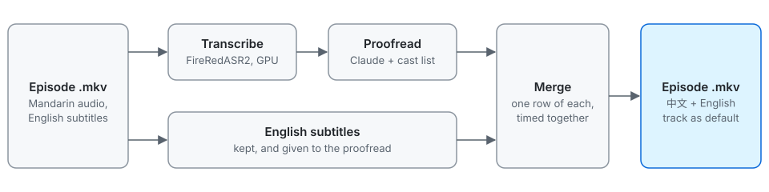

# dual-subs

Chinese and English subtitles on screen together, for shows that only ship English subtitles. It transcribes each episode's Mandarin audio and adds a "中文 + English" track to the MKV, so Plex plays both at once.

[](https://github.com/ColinCee/dual-subs/actions/workflows/check.yml)
[](LICENSE)




## Quick start

```bash
git clone https://github.com/ColinCee/dual-subs && cd dual-subs
```

```bash
uv run dual-subs "E:/TV/My Show" --names names/my-show.txt --backup "E:/originals/My Show"
```

It takes MKV episodes with Mandarin audio and full English subtitles, a season folder or single files. Originals move to `--backup`, which must be on the same drive. Re-running is safe: episodes already done are skipped.

## Requirements

Tested on Windows only.

| Needs | Get it |
|---|---|
| NVIDIA GPU, driver 570 or newer | [NVIDIA drivers](https://www.nvidia.com/en-us/drivers/) |
| Git | `winget install Git.Git` |
| [uv](https://docs.astral.sh/uv/) | `winget install astral-sh.uv` |
| `ffmpeg` and `ffprobe` | `winget install Gyan.FFmpeg` |
| [MKVToolNix](https://mkvtoolnix.download/) | `winget install MoritzBunkus.MKVToolNix` |
| [Claude Code](https://docs.anthropic.com/en/docs/claude-code), signed in | `npm install -g @anthropic-ai/claude-code` |

The first run downloads the [FireRedASR2](https://github.com/FireRedTeam/FireRedASR2S) weights (about 6 GB, to `D:/models/fireredasr2s` or `DUAL_SUBS_MODELS`), PyTorch with CUDA (a few GB) and the Noto Sans SC font. The proofread runs `claude -p`, so it uses your own Claude plan.

## A new show

Add `names/<show>.txt` with the cast's names and any mishearings you spot, like [names/to-be-hero-x.txt](names/to-be-hero-x.txt). In the episode measured, names were about a third of the transcriber's mistakes.

## Watching in Plex

- Plex keeps your earlier subtitle pick per episode. For episodes already watched, pick "中文 + English" once.
- The iPad and iPhone apps show only the English. Set Burn Subtitles to Always in the app's settings to see both; the server then re-encodes the video.

<details>
<summary>How it works</summary>

| Step | Code |
|---|---|
| Transcribe the Mandarin audio ([why this model](docs/adr/0001-speech-to-text.md)) | `src/dual_subs/transcribe.py` |
| Claude fixes mishearings, using the English line and cast list | `proofread.py` |
| Pair each Chinese row with its English line | `ass.py` |
| Write a checked copy, swap it in, keep the original | `mkv.py`, `cli.py` |

Transcripts and proofread lines are cached in `~/.cache/dual-subs/`; delete an episode's file there to redo it.

If other GPU jobs share the machine, run it under [`lease`](https://github.com/ColinCee/agents/blob/main/src/lease/lease.mts) so only one holds the GPU: `lease run --name dual-subs --res gpu --for 7200 -- uv run dual-subs ...`.

</details>

## License

[MIT](LICENSE)
